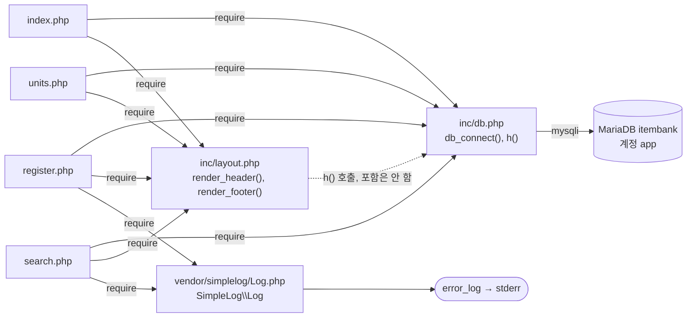

# item-bank-php 아키텍처 (진입점 · 의존 관계)

> 대상: `legacy/item-bank-php/` · 범위: 진입점과 의존 관계 분석 결과.
> `search.php` 는 1–120줄 · 520–731줄 전문과 함수 · 호출 위치 grep 만 확인했다. 121–519줄 본문은 읽지 않았다.

## 1. 모듈 개요

- 문항 은행 레거시 화면. PHP 7.4 + Apache 에서 PHP 파일이 곧 URL 이다 (`Dockerfile:1`, `Dockerfile:14`). 외부 포트는 8081 이다 (`docker-compose.yml` `8081:80`).
- 화면은 홈 · 단원 목록 · 문항 등록 · 문항 검색 4개다 (`index.php:9-11`).
- 공통 코드는 `inc/db.php`(DB 연결 · `h()` 이스케이프)와 `inc/layout.php`(머리말 · 꼬리말)이다. 로그는 외부 라이브러리 `vendor/simplelog` 가 남긴다.
- DB 는 mysqli 로 MariaDB `itembank` 에 쓰기 계정 `app` 으로 접속한다 (`inc/db.php:14-21`, compose `DB_USER: app`).

## 2. 폴더 구조

```
legacy/item-bank-php/
├── Dockerfile                 16줄  php:7.4-apache, mysqli, rewrite, 폴더 전체 COPY
├── index.php                  14줄  홈 메뉴
├── units.php                  48줄  단원 목록
├── register.php              177줄  문항 등록 (GET 폼 / POST 등록)
├── search.php                731줄  문항 검색
├── inc/
│   ├── db.php                 37줄  db_connect(), h()
│   └── layout.php             43줄  render_header(), render_footer()
└── vendor/
    └── simplelog/Log.php      54줄  외부 라이브러리 (공개 API 만 확인)
```

- `.htaccess` 는 없다(파일 목록으로 확인). `a2enmod rewrite` 는 켜져 있다 (`Dockerfile:4`).
- 빌드 산출물 · `node_modules` 는 모듈 안에 없다.

## 3. 진입점

| URL / 화면 | 처음 실행되는 파일 | 부르는 주요 함수 (근거) |
|---|---|---|
| `/` · `/index.php` 홈 메뉴 | `index.php` | `render_header('홈')` `index.php:5`, `render_footer()` `index.php:14`. 메뉴 링크 3개 `index.php:9-11`. `inc/db.php` 를 포함만 하고 DB 호출은 없다 `index.php:2` |
| `/units.php` 단원 목록 (GET) | `units.php` | `render_header` `units.php:5`, `db_connect` `units.php:8`, `$conn->query` `units.php:20`, `h` `units.php:40-43`, `render_footer` `units.php:48` |
| `/register.php` 문항 등록 (GET 폼 / POST 등록 `register.php:40`) | `register.php` | `db_connect` `register.php:17`, `query` `register.php:27`, `:34`, `:87`, `begin_transaction` `:85`, `prepare`/`bind_param`/`execute` `:92-99`, `:105-108`, `commit` `:114`, `rollback` `:120`, `Log::info` `:115`, `Log::error` `:121`, `render_header` `:127`, `h` `:131-171`, `render_footer` `:177` |
| `/search.php` 문항 검색 (GET) | `search.php` | `Log::setThreshold` `search.php:27`, `render_header` `:709`, `db_connect` `:713`, `buildSearchQuery($_GET, …)` `:722`, `renderSearchForm` `:723`, `runSearchQuery` `:724`, `renderResultTable` `:725`, `Log::error` `:727`, `render_footer` `:731` |

## 4. 의존 관계

화살표 방향은 "A → B (A가 B를 포함 또는 호출)"이다.



### 파일 포함 (require_once)

| A → B | 근거 |
|---|---|
| `index.php` → `inc/db.php` | `index.php:2` |
| `index.php` → `inc/layout.php` | `index.php:3` |
| `units.php` → `inc/db.php` | `units.php:2` |
| `units.php` → `inc/layout.php` | `units.php:3` |
| `register.php` → `inc/db.php` | `register.php:2` |
| `register.php` → `inc/layout.php` | `register.php:3` |
| `register.php` → `vendor/simplelog/Log.php` | `register.php:4`, `use` `register.php:6` |
| `search.php` → `inc/db.php` | `search.php:20` |
| `search.php` → `inc/layout.php` | `search.php:21` |
| `search.php` → `vendor/simplelog/Log.php` | `search.php:22`, `use` `search.php:24` |

`inc/*.php` 와 `Log.php` 는 다른 파일을 포함하지 않는다(전문 확인).

### 함수 호출

| A → B | 호출 | 근거 |
|---|---|---|
| `inc/layout.php` → `inc/db.php` | `render_header` 가 `h()` 호출 | `inc/layout.php:17`, `:33` |
| `units.php` → `inc/db.php` | `db_connect()`, `h()` | `units.php:8`, `:40-43` |
| `register.php` → `inc/db.php` | `db_connect()`, `h()` | `register.php:17`, `:131-171` |
| `search.php` → `inc/db.php` | `db_connect()`, `h()` | `search.php:713`, `:715`, `:674-678`, `:690-700` |
| 진입점 4개 → `inc/layout.php` | `render_header()`, `render_footer()` | §3 표의 줄번호 |
| `register.php` → `Log.php` | `Log::info`, `Log::error` | `register.php:115`, `:121` |
| `search.php` → `Log.php` | `Log::setThreshold`, `Log::debug`, `Log::error` | `search.php:27`, `:103`, `:528`, `:537`, `:727` |
| `Log.php` → PHP 내장 | `error_log()` (stderr) | `Log.php:52`, `Dockerfile:11` |
| `inc/db.php` → MariaDB | `new mysqli(...)`, 기본 계정 `app`/`app-pass` | `inc/db.php:14-21`, `:17-18` |

`layout.php` 는 `db.php` 를 포함하지 않으므로 `db.php` 를 먼저 포함해야 동작한다. 진입점 4개 모두 `db.php` 를 먼저 포함한다.

### search.php 내부 호출

| A → B | 근거 |
|---|---|
| 최상위 → `buildSearchQuery` → `renderSearchForm` → `runSearchQuery` → `renderResultTable` | `search.php:722-725` |
| `buildSearchQuery` → `$conn` 조회 3건 | `search.php:125` (prepare), `:156` (query), `:178` (query) |
| `buildSearchQuery` → `h()` 19회 | grep 결과 (`search.php:42-564`) |
| `buildSearchQuery` → `Log::debug`, `Log::error` | `search.php:103`, `:528`, `:537` |
| `renderResultTable` → `h()` | `search.php:674-678`, `:690-700` |

### DB 객체 참조 (확인한 범위)

| 파일 | 객체 | 근거 |
|---|---|---|
| `units.php` | `unit`, `item` | `units.php:16-19` |
| `register.php` | `unit`, `tag`, `item`, `item_tag` | `register.php:27`, `:34`, `:87`, `:93`, `:105` |
| `search.php` | `unit` | `search.php:125`, `:156` |
| `search.php` | `tag` | `search.php:178` |
| `search.php` | 뷰 `v_item_public` | `search.php:522` |

## 5. 가장 긴 함수 3개

모듈 자체 함수 8개 기준(vendor 제외).

| 순위 | 파일 | 함수 | 시작–끝 | 길이 | 하는 일 |
|---|---|---|---|---|---|
| 1 | `search.php` | `buildSearchQuery` | 42–564 | 523줄 | GET 파라미터로 WHERE · ORDER · LIMIT SQL 과 바인딩 값을 조립하고, 폼 · 요약 · 정렬 링크 HTML 까지 만들어 배열로 반환한다 (주석 `search.php:29-41`, 반환 `search.php:541-563`) |
| 2 | `search.php` | `renderResultTable` | 647–704 | 58줄 | 경고 · 요약 · 건수, 결과 표, 페이지 링크를 출력한다. 0건이면 안내 문구만 출력한다 (`search.php:657-660`) |
| 3 | `search.php` | `runSearchQuery` | 571–624 | 54줄 | 건수 SQL 과 페이지 SQL 을 같은 바인딩으로 두 번 실행해 `total` · `rows` 를 반환한다 (`search.php:577-623`) |

나머지: `render_header` `inc/layout.php:7-36`, `db_connect` `inc/db.php:7-29`, `renderSearchForm` `search.php:629-641`, `render_footer` `inc/layout.php:38-43`, `h` `inc/db.php:34-37`.

### 확인 중 드러난 관찰

- `buildSearchQuery` 한 함수가 모듈 코드의 약 절반(523/약 1,100줄)이며, 쿼리 조립과 HTML 생성이 섞여 있다 (`search.php:541-551`).
- `renderSearchForm`(`search.php:633-637`)과 `renderResultTable`(`search.php:652-653`, `:665-669`)은 `buildSearchQuery` 가 만든 HTML 조각을 이스케이프 없이 echo 한다.
- `search.php:103` 의 키워드 `Log::debug` 는 threshold 가 INFO(`search.php:27`, `Log.php:45`)라 기록되지 않는다.
- DB 접속 계정이 쓰기 계정 `app` 이다 (`inc/db.php:17`). 프로젝트 규칙상 조회는 `readonly` 계정이어야 한다.

## 6. 미확인 목록

| 항목 | 이유 |
|---|---|
| `search.php` 121–519줄 본문 전체 | 읽지 않음 (grep 으로 줄번호만 확인) |
| `search.php:125`, `:156`, `:178` 조회 3건의 용도 | 121–519줄 미열람 |
| `buildSearchQuery` 안의 `h()` 19회가 어떤 값을 이스케이프하는지 | 121–519줄 미열람 |
| `summary_html` · `warning_html` · `form_html` · `sort_links` 가 안전하게 만들어지는지 (위 이스케이프 없는 echo 의 안전성) | 121–519줄 미열람 |
| `inc/*.php` · `vendor/**` 를 URL 로 직접 요청했을 때의 실제 응답 | 정의만 있어 출력이 없을 것으로 보이나 실행해 보지 않음 |
| ~~`v_item_public` 뷰 정의와 `item` · `unit` · `tag` · `item_tag` 스키마~~ | 해소 — 이 문서에서는 읽지 않았고, ERD.md §1 · BUSINESS-RULES.md BR-01 에서 `01-schema.sql:51-70` 으로 확인(제외 조건 `status = 'A'` 하나) |

## 7. 검증 이력

| 날짜 | 항목 | 바뀐 내용 | 근거 |
|---|---|---|---|
| 2026-09-29 | §6 뷰 정의 미확인 행 | 교차 검증(BUSINESS-RULES.md §8, BR-01)으로 해소 표시. 본문은 변경 없음 | `01-schema.sql:51-70` |
