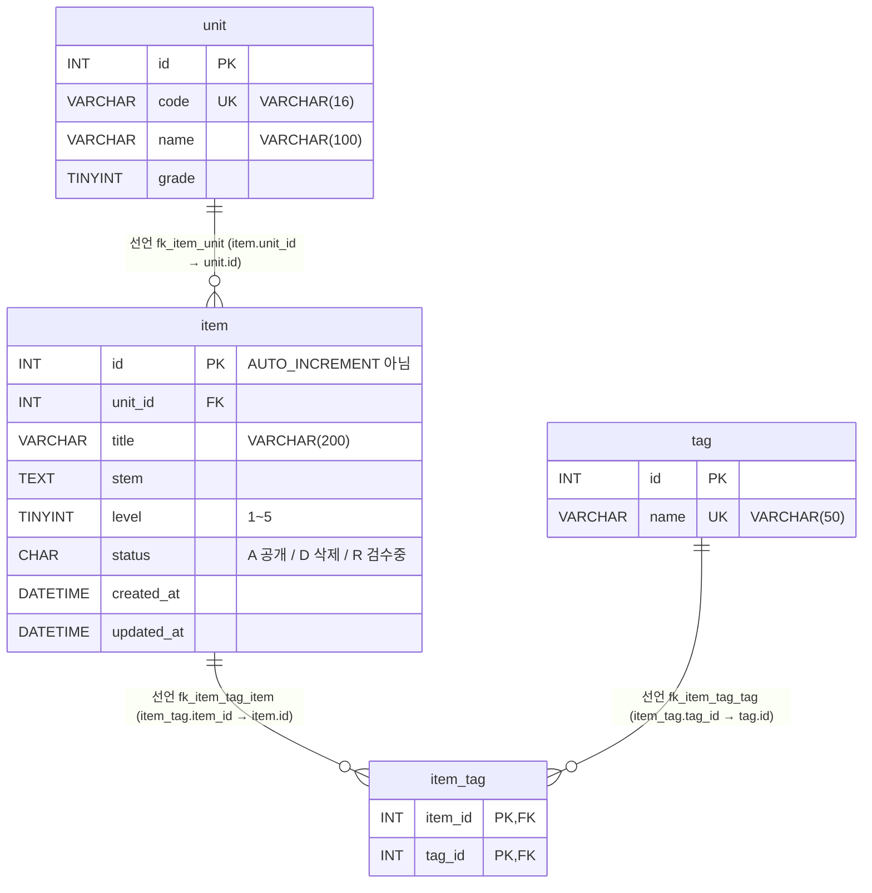
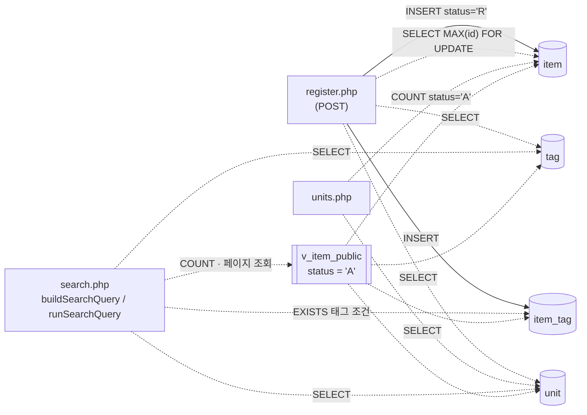

# item-bank-php 데이터 흐름 (ERD · 읽기/쓰기 위치)

> 대상: `legacy/item-bank-php/` · 선행 문서: [ARCHITECTURE.md](ARCHITECTURE.md)
> 근거 파일: 스키마 `db/mariadb/init/01-schema.sql`, 시드 `db/mariadb/init/02-seed.sql`, 계정 `db/mariadb/init/03-users.sql`, PHP 소스 전체.
> SQL 문은 모듈 전체를 `SELECT|INSERT|UPDATE|DELETE|FROM|JOIN|query|prepare` 로 grep 한 뒤 해당 줄 주변을 읽어 확인했다.

## 1. 테이블 목록

모듈이 참조하는 DB 객체는 테이블 4개와 뷰 1개다. 모두 MariaDB `itembank` 에 있다.

| 테이블 | 주요 컬럼 | 근거 |
|---|---|---|
| `unit` (단원) | `id` INT PK, `code` VARCHAR(16) UNIQUE(`uk_unit_code`), `name` VARCHAR(100), `grade` TINYINT | 정의 `01-schema.sql:11-18` · 조회 `units.php:16-19`, `register.php:27`, `search.php:125`, `:156` |
| `item` (문항) | `id` INT PK, `unit_id` INT FK→`unit.id`, `title` VARCHAR(200), `stem` TEXT, `level` TINYINT(1~5, 주석), `status` CHAR(1) 기본 `'A'`(A=공개 D=삭제 R=검수중, 주석), `created_at` DATETIME, `updated_at` DATETIME. 인덱스 `idx_item_unit`, `idx_item_level` | 정의 `01-schema.sql:20-33` · 조회 `units.php:17`, `register.php:87` · 쓰기 `register.php:93-94` |
| `tag` (태그) | `id` INT PK, `name` VARCHAR(50) UNIQUE(`uk_tag_name`) | 정의 `01-schema.sql:35-40` · 조회 `register.php:34`, `search.php:178`, `:244` |
| `item_tag` (문항-태그 연결) | `item_id` INT FK→`item.id`, `tag_id` INT FK→`tag.id`, PK(`item_id`, `tag_id`) | 정의 `01-schema.sql:42-48` · 조회 `search.php:244` · 쓰기 `register.php:105` |
| 뷰 `v_item_public` | `id`, `unit_id`, `unit_code`, `unit_name`, `unit_grade`, `title`, `stem`, `level`, `created_at`, `updated_at`, `tag_names`(태그 이름 `GROUP_CONCAT`, `t.id` 순, 쉼표 구분). 조건 `item.status = 'A'` | 정의 `01-schema.sql:52-70` · 조회 `search.php:521-526` |

참고:

- `item.id` 는 `AUTO_INCREMENT` 가 아니다(`01-schema.sql:21`). 등록 화면이 `SELECT COALESCE(MAX(id), 0) + 1 … FOR UPDATE` 로 번호를 만든다 (`register.php:87-90`).
- 같은 DB 에 과제 배포 테이블(`class` · `assignment` · `distribution` · `submission`, `01-schema.sql:75-115`)도 있으나 이 모듈은 참조하지 않는다(grep 결과 0건). 그중 `assignment.unit_id` 가 `unit.id` 를 FK 로 참조한다 (`01-schema.sql:85`, `:89`) — `unit` 을 바꿀 때 영향 범위에 들어간다.

## 2. 테이블 관계

- **선언**: `01-schema.sql` 에 `FOREIGN KEY` 로 선언된 관계.
- **추정**: 선언은 없고 코드의 JOIN · 조건에서만 드러나는 관계.

이 모듈에서 찾은 관계 3개는 모두 FK 로 선언돼 있고, 코드 · 뷰의 JOIN 도 같은 컬럼으로 이어 붙인다. **FK 없이 JOIN 에서만 추정되는 관계는 발견하지 못했다.**

| 관계 | 구분 | 선언 근거 | 같은 관계를 쓰는 JOIN · 조건 |
|---|---|---|---|
| `unit` 1 : N `item` | 선언 | `01-schema.sql:32` | 뷰 `JOIN unit u ON u.id = i.unit_id` `01-schema.sql:69` · 상관 서브쿼리 `i.unit_id = u.id` `units.php:17` |
| `item` 1 : N `item_tag` | 선언 | `01-schema.sql:46` | 뷰 `WHERE it.item_id = i.id` `01-schema.sql:67` · `it.item_id = v_item_public.id` `search.php:245` |
| `tag` 1 : N `item_tag` (→ `item` N : M `tag`) | 선언 | `01-schema.sql:47` | 뷰 `JOIN tag t ON t.id = it.tag_id` `01-schema.sql:66` · `search.php:244` |

카디널리티 메모: `item.unit_id` 가 `NOT NULL` 이라 문항은 반드시 단원 하나에 속한다(`01-schema.sql:22`). 단원에 문항이 0개일 수 있는지는 제약이 없으므로 `o{`(0 이상)로 그렸다.

## 3. 읽기 · 쓰기 위치

모듈 전체(파일 8개, `vendor/` 포함)에 갱신문(`UPDATE … SET`) · `DELETE` 문은 없다. `UPDATE` 로 grep 하면 `register.php:87` 채번 쿼리의 행 잠금 절 `FOR UPDATE` 1건만 나온다. 쓰기는 `register.php` 의 `INSERT` 2건뿐이다. 함수 밖 최상위 코드는 "(최상위)"로 적는다.

### `unit`

| 구분 | 파일 · 함수 | SQL | 근거 |
|---|---|---|---|
| 읽기 | `units.php` (최상위) | `SELECT u.id, u.code, u.name, u.grade, (서브쿼리) FROM unit u ORDER BY u.grade, u.code` — 단원 목록 | `units.php:16-20` |
| 읽기 | `register.php` (최상위) | `SELECT id, code, name FROM unit ORDER BY grade, code` — 단원 선택 목록 · 입력 검증 | `register.php:27`, 검증 `:60-68` |
| 읽기 | `search.php` `buildSearchQuery` | `SELECT name, grade FROM unit WHERE code = ?` — 단원 코드 검색 시 이름 확인 · 미등록 경고 | `search.php:125-127`, `:142-145` |
| 읽기 | `search.php` `buildSearchQuery` | `SELECT code, name, grade FROM unit ORDER BY grade, code` — 검색 폼 단원 선택지 | `search.php:156` |
| 읽기(뷰 경유) | `search.php` `runSearchQuery` | `v_item_public` 의 `unit_code` (뷰가 `unit` 을 JOIN) | `search.php:521-526`, `:577`, `:600` |
| 쓰기 | — | 없음 | grep 0건 |

### `item`

| 구분 | 파일 · 함수 | SQL | 근거 |
|---|---|---|---|
| 읽기 | `units.php` (최상위) | `SELECT COUNT(*) FROM item i WHERE i.unit_id = u.id AND i.status = 'A'` — 단원별 공개 문항 수 | `units.php:17` |
| 읽기 | `register.php` (최상위, POST) | `SELECT COALESCE(MAX(id), 0) + 1 AS next_id FROM item FOR UPDATE` — 새 ID 채번(트랜잭션 안) | `register.php:85-90` |
| 읽기(뷰 경유) | `search.php` `runSearchQuery` | `SELECT COUNT(*) … FROM v_item_public WHERE …` (건수) / `SELECT id, title, unit_code, level, tag_names, created_at FROM v_item_public WHERE … ORDER BY … LIMIT 20 OFFSET n` (페이지). SQL 조립은 `buildSearchQuery` | 조립 `search.php:521-526`, 실행 `:577-597`, `:600-621` |
| 쓰기 INSERT | `register.php` (최상위, POST) | `INSERT INTO item (id, unit_id, title, stem, level, status, created_at, updated_at) VALUES (?, ?, ?, ?, ?, 'R', NOW(), NOW())` | `register.php:92-101` |
| 쓰기 UPDATE · DELETE | — | 없음 | 갱신문 · 삭제문 0건(`FOR UPDATE` 잠금 절 1건 제외, `register.php:87`) |

`search.php` 가 뷰에 거는 조건 컬럼: `title` · `stem` LIKE (`search.php:98`), `unit_code` (`:118`), `level` (`:215`, `:218`, `:226`), 태그 EXISTS (`:244-245`). 정렬 컬럼: `id` · `title` · `unit_code` · `level` · `created_at` (`search.php:281-325`).

### `tag`

| 구분 | 파일 · 함수 | SQL | 근거 |
|---|---|---|---|
| 읽기 | `register.php` (최상위) | `SELECT id, name FROM tag ORDER BY id` — 태그 체크박스 · 입력 검증 | `register.php:34`, 검증 `:74-81` |
| 읽기 | `search.php` `buildSearchQuery` | `SELECT name FROM tag ORDER BY id` — 검색 폼 태그 선택지 · 미등록 경고 | `search.php:178`, `:253-259` |
| 읽기 | `search.php` `buildSearchQuery` → `runSearchQuery` | `EXISTS (SELECT 1 FROM item_tag it JOIN tag t ON t.id = it.tag_id WHERE it.item_id = v_item_public.id AND t.name = ?)` | `search.php:244-247` |
| 읽기(뷰 경유) | `search.php` `runSearchQuery` | `v_item_public.tag_names` | `search.php:521` |
| 쓰기 | — | 없음 | grep 0건 |

### `item_tag`

| 구분 | 파일 · 함수 | SQL | 근거 |
|---|---|---|---|
| 읽기 | `search.php` `buildSearchQuery` → `runSearchQuery` | 위 태그 EXISTS 서브쿼리 | `search.php:244-245` |
| 읽기(뷰 경유) | `search.php` `runSearchQuery` | `v_item_public.tag_names` 서브쿼리 | `search.php:521`, 뷰 `01-schema.sql:64-67` |
| 쓰기 INSERT | `register.php` (최상위, POST) | `INSERT INTO item_tag (item_id, tag_id) VALUES (?, ?)` — 검증 통과한 태그마다 1건, `item` INSERT 와 같은 트랜잭션 | `register.php:104-113`, commit `:114`, rollback `:120` |
| 쓰기 UPDATE · DELETE | — | 없음 | 갱신문 · 삭제문 0건(`FOR UPDATE` 잠금 절 1건 제외, `register.php:87`) |

### 흐름 요약

실선은 쓰기, 점선은 읽기다.

### 확인 중 드러난 관찰

- **등록한 문항이 이 모듈에서는 영영 공개되지 않는다.** 등록은 `status='R'` 로 넣고(`register.php:94`), 검색은 `status='A'` 인 뷰만 본다(`01-schema.sql:70`). `R → A` 로 바꾸는 `UPDATE` 는 이 모듈에 없다. 검수 · 승인을 어디서 하는지는 미확인이다.
- `updated_at` 은 INSERT 때 `NOW()` 로 한 번 채워지고 바뀌는 코드가 없다. `created_at` · `updated_at` 모두 DB 서버 시각(`NOW()`)이다 (`register.php:94`).
- `status = 'D'`(삭제)로 바꾸는 코드도 없다. 삭제 기능은 이 모듈에 없다.
- 스키마 주석(`01-schema.sql:51`)은 "등록 화면도 이 뷰를 기준으로 삼는다"고 하지만, `register.php` 는 뷰를 참조하지 않는다(grep 0건).
- `MAX(id)+1 … FOR UPDATE` 채번은 테이블 전체 잠금에 가깝게 동작할 수 있고, 동시 등록 시 대기가 생긴다. 실제 잠금 범위는 실행해 보지 않아 확인하지 않았다.
- 모든 접속이 쓰기 계정 `app`(`inc/db.php:17`, `03-users.sql:9-10`, 전체 권한)이다. 읽기만 하는 `units.php` · `search.php` 도 같은 계정이다.

## 4. 미확인 목록

| 항목 | 이유 |
|---|---|
| `item.status` 를 `R → A` 또는 `→ D` 로 바꾸는 주체 | 이 모듈 · 스키마에 해당 UPDATE 가 없음. 다른 모듈(`modern/api` 등)이나 수작업일 수 있으나 찾아보지 않음 |
| `level` 1~5 범위의 DB 제약 | 스키마에는 주석뿐이고 CHECK 제약이 없음(`01-schema.sql:25`). 입력 검증은 `register.php:70` 에만 있음 |
| `status` 허용 값(A · D · R 외 값)의 DB 제약 | 주석뿐, CHECK 제약 없음(`01-schema.sql:26`) |
| DB 트리거 · 저장 프로시저 존재 여부 | `01-schema.sql` 에 없음. 운영 DB 에 별도로 있는지는 확인하지 않음 |
| `FOR UPDATE` 채번의 실제 잠금 범위 · 동시성 동작 | 실행해 보지 않음 |
| `search.php` 121–519줄 중 SQL 이 없는 부분(HTML 조립)의 세부 | 데이터 흐름과 무관해 grep 결과 주변만 읽음. SQL · 테이블 참조는 grep 으로 전부 잡았다 |

## 5. 검증 이력

| 날짜 | 항목 | 바뀐 내용 | 근거 |
|---|---|---|---|
| 2026-09-29 | §3 UPDATE · DELETE 없음 | 교차 검증(BUSINESS-RULES.md §8)에서 "grep 0건"이 `FOR UPDATE` 1건과 충돌해 표현을 정밀화. 결론(갱신 · 삭제 없음)은 유지 | `register.php:87`, `find legacy/item-bank-php -type f` |
